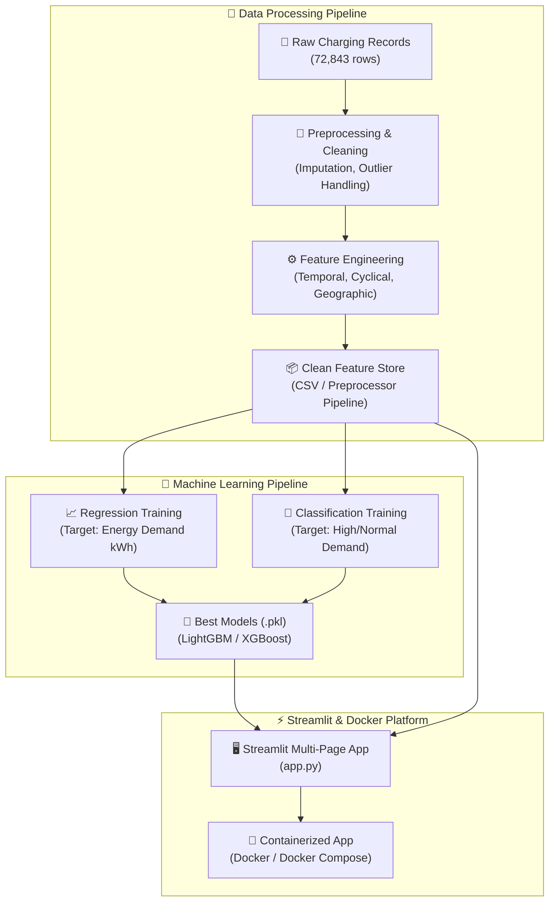

<div align="center">

# ⚡ EV Charging Analytics & Demand Prediction Platform

### *Next-Gen Machine Learning & Exploratory Intelligence for Electric Vehicle Infrastructure*

[](https://www.python.org/)
[](https://streamlit.io/)
[](https://www.docker.com/)
[](https://scikit-learn.org/)
[](https://xgboost.readthedocs.io/)
[](https://lightgbm.readthedocs.io/)
[](LICENSE)

<p align="center">
  <a href="#-key-features">Key Features</a> •
  <a href="#-architecture--workflow">Architecture</a> •
  <a href="#-model-benchmarks">Model Benchmarks</a> •
  <a href="#-docker-quickstart">Docker Quickstart</a> •
  <a href="#-local-installation">Local Setup</a> •
  <a href="#-project-structure">Project Structure</a>
</p>

</div>

---

## 📖 Overview

The **EV Charging Analytics Platform** is an enterprise-grade data science and machine learning application designed to forecast energy demand and analyze electric vehicle charging patterns across modern smart grids. 

Leveraging historical charging records across **72,800+ real-world EV charging sessions**, this system delivers actionable insights for grid operators, charging station network managers, and urban infrastructure planners.

```
       72,800+ Sessions Analyzed       |       6 ML Models Evaluated       |       Sub-Second Inference
```

---

## 🌟 Key Features

### 📊 1. Executive Intelligence Dashboard
- **KPI Command Center**: Real-time tracking of total charging sessions, cumulative power delivered (kWh), average session duration, peak operational hours, and utilization ratios.
- **Interactive Visualizations**: Powered by Plotly — hourly demand heatmaps, temporal load curves, charger company distributions, and weekday vs. weekend charging patterns.
- **Correlation Matrix**: Deep correlation analysis between duration, hour of day, day of week, charger specifications, and energy delivered.

### 📈 2. Regression Engine (Continuous Energy Demand)
- Predicts exact energy consumption ($kWh$) for individual charging sessions.
- Multi-model evaluation comparing **LightGBM**, **XGBoost**, **Gradient Boosting**, **Linear Regression**, **Random Forest**, and **Decision Trees**.
- Automated evaluation metrics: **MAE**, **MSE**, **RMSE**, and **$R^2$ Score**.
- Residual distribution and Actual vs. Predicted regression plots.

### 🎯 3. Classification Engine (High vs. Normal Demand)
- Classifies incoming sessions into **High Demand** ($\ge 14.12\text{ kWh}$) vs. **Normal Demand** (< $14.12\text{ kWh}$) categories for proactive peak-load shaving.
- Evaluates models across **Accuracy**, **Precision**, **Recall**, **F1-Score**, and **ROC-AUC**.
- Interactive confusion matrix visualizer and ROC curve plots.

### 🔮 4. Real-Time What-If Prediction Simulator
- Test arbitrary operational scenarios with custom user inputs:
  - Charger Company & Hardware Type (Level 2 AC vs. DC Fast Chargers)
  - Station Geographic Location
  - Plug-in Timestamp, Hour of Day & Day of Week
  - Estimated Duration (hours/minutes)
- Simultaneous **continuous demand ($kWh$)** and **binary load classification** output with instant visual confidence gauges.

### 🔍 5. Interactive Data Explorer
- Deep-dive into raw & feature-engineered datasets.
- Column-wise filtering, multi-condition querying, statistical summary generation, and instant one-click CSV export.

---

## 🏗️ Architecture & Workflow



---

## 🏆 Model Benchmarks

### 📈 Regression Leaderboard (Target: `Demand` in $kWh$)

| Rank | Model | MAE ($kWh$) | MSE | RMSE ($kWh$) | $R^2$ Score |
| :---: | :--- | :---: | :---: | :---: | :---: |
| 🥇 | **LightGBM Regressor** | **9.4177** | **155.23** | **12.459** | **0.1561** |
| 🥈 | **XGBoost Regressor** | 9.4391 | 156.02 | 12.491 | 0.1519 |
| 🥉 | **Gradient Boosting** | 9.5200 | 158.01 | 12.570 | 0.1410 |
| 4 | **Linear Regression** | 9.7997 | 165.36 | 12.859 | 0.1011 |
| 5 | **Random Forest** | 10.3116 | 190.20 | 13.791 | -0.0340 |
| 6 | **Decision Tree** | 11.0731 | 227.26 | 15.075 | -0.2354 |

---

### 🎯 Classification Leaderboard (Target: `High Demand`)

| Rank | Model | Accuracy | Precision | Recall | F1-Score | ROC-AUC |
| :---: | :--- | :---: | :---: | :---: | :---: | :---: |
| 🥇 | **LightGBM Classifier** | **65.50%** | 63.51% | **72.06%** | **0.6752** | **0.7165** |
| 🥈 | **XGBoost Classifier** | 65.42% | **63.90%** | 70.10% | 0.6686 | 0.7135 |
| 🥉 | **Gradient Boosting** | 64.78% | 63.31% | 69.47% | 0.6625 | 0.7052 |
| 4 | **Logistic Regression** | 62.93% | 62.67% | 63.07% | 0.6287 | 0.6722 |
| 5 | **Random Forest** | 60.61% | 60.14% | 61.75% | 0.6094 | 0.6519 |
| 6 | **Decision Tree** | 59.92% | 60.71% | 55.12% | 0.5778 | 0.6264 |

---

## 🐳 Docker Quickstart

Deploy the entire analytics platform with a single command using Docker.

### 1. Clone & Navigate
```bash
git clone https://github.com/your-username/EV-Charging-Analytics.git
cd EV-Charging-Analytics
```

### 2. Run with Docker Compose
```bash
# Build and start container in detached mode
docker compose up --build -d
```

### 3. Access Dashboard
Navigate to [**http://localhost:8501**](http://localhost:8501) in your browser.

### 4. Stop Container
```bash
docker compose down
```

---

## 💻 Local Installation (Without Docker)

### Prerequisites
- Python **3.10+** / **3.11** installed
- Git

```bash
# 1. Clone repository
git clone https://github.com/your-username/EV-Charging-Analytics.git
cd EV-Charging-Analytics

# 2. Create and activate a virtual environment
python -m venv venv

# Windows:
.\venv\Scripts\activate
# macOS / Linux:
source venv/bin/activate

# 3. Install dependencies
pip install -r requirements.txt

# 4. Launch the Streamlit application
streamlit run app.py
```

---

## 📁 Project Structure

```plaintext
EV-Charging-Analytics/
│
├── 📊 app.py                             # Main Streamlit web application & UI
├── 🐳 Dockerfile                         # Production-ready container recipe
├── 🐙 docker-compose.yml                 # Multi-platform container orchestration
├── 📋 requirements.txt                   # Python package dependencies
├── 🚫 .dockerignore                      # Docker build exclusions
├── 📖 README.md                          # Project documentation
│
├── 📂 analysis/                          # Jupyter Research & Prototyping Notebooks
│   ├── 01_dataset_exploration.ipynb      # Raw data exploration
│   ├── 02_data_preprocessing.ipynb       # Cleaning, outlier rejection & imputation
│   ├── 03_exploratory_data_analysis.ipynb# Trend, seasonal & spatial analysis
│   ├── 04_feature_engineering.ipynb      # Feature derivation & transformation
│   ├── 05_ml_data_preparation.ipynb      # Train/test split & scaling pipelines
│   ├── 06_regression_model.ipynb         # Regression experimentation
│   └── 07_classification_model.ipynb     # Classification experimentation
│
├── 📂 data/                              # Datasets & Processed Feature Stores
│   ├── ChargingRecords.csv               # Raw charging telemetry
│   ├── cleaned_charging_data.csv         # Cleaned baseline dataset
│   ├── feature_engineered_data.csv       # Production feature set (72,843 records)
│   ├── X_train.csv / X_test.csv          # Feature matrices
│   └── y_train_*.csv / y_test_*.csv      # Target variables (regression & classification)
│
├── 📂 trained_models/                    # Serialized Machine Learning Artifacts
│   ├── best_regression_model.pkl         # Production LightGBM Regressor
│   ├── best_classification_model.pkl     # Production LightGBM Classifier
│   ├── preprocessor.pkl                  # Fitted Scikit-learn ColumnTransformer
│   └── demand_threshold.pkl              # Optimal classification threshold value
│
└── 📂 outputs/                           # Benchmark Reports & Visual Artifacts
    ├── regression_model_comparison.csv   # Regression benchmark results
    ├── classification_model_comparison.csv # Classification benchmark results
    └── *.png                             # High-res confusion matrix & importance plots
```

---

## 🛠️ Technology Stack

<div align="center">

| Domain | Technologies |
| :--- | :--- |
| **Frontend / Web App** | `Streamlit`, `Plotly`, `HTML5/CSS3 Custom Components` |
| **Machine Learning** | `LightGBM`, `XGBoost`, `Scikit-learn`, `Joblib` |
| **Data Engineering** | `Pandas`, `NumPy`, `Jupyter Notebooks` |
| **DevOps & Packaging** | `Docker`, `Docker Compose`, `OpenMP (libgomp1)` |

</div>

---

## 🤝 Contributing

Contributions, issues, and feature requests are welcome!
1. Fork the Project
2. Create your Feature Branch (`git checkout -b feature/AmazingFeature`)
3. Commit your Changes (`git commit -m 'Add some AmazingFeature'`)
4. Push to the Branch (`git push origin feature/AmazingFeature`)
5. Open a Pull Request

---

## 📄 License

Distributed under the **MIT License**. See `LICENSE` for more information.

<div align="center">
  <sub>Built with ⚡ for the future of Smart Mobility & Clean Energy Infrastructure</sub>
</div>
